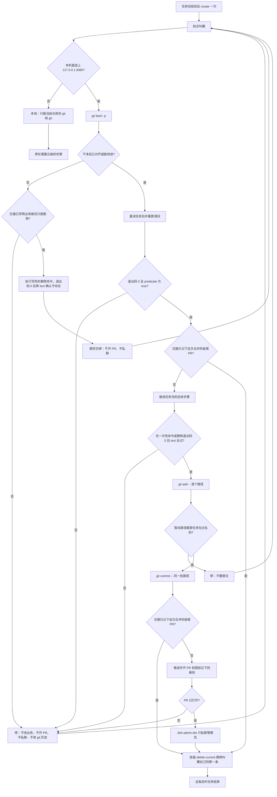

# use-cloud-harness

本技能规定云上 deepseek-harness 怎么听 PR 与 Release、怎么对齐仓库、怎么收尾、怎么通知，给以后任何仓库的云上任务复用。业务怎么改，写在各自的任务包里，不写在这里。

违反条文就是违反这条纪律。谓词不成立时，人的一句话、未发版的默认分支、对调 compare，都不能当成成立。

仓库里的文件用仓库相对路径。机器上的长期入口和一次性安装路径不是仓库路径，按任务包原文写。不写凭据，不写家目录。本技能自己的脚本不写成任务仓库相对路径。

## 执行位置

本机能连上 `127.0.0.1:3080` 的 deepseek-harness 才是云端，否则是本地。云端才做调度、对齐、谓词、私聊。本地只做当前仓库的 git 和 gh，不创建调度，不私聊，不 SSH。本地找不到 use-vps 是正常的，停在需要云端的那一步。

谓词脚本是正在读的这份 SKILL.md 旁边的 `scripts/dsh-pr-release-predicate`。调度命令是正在读的这份 SKILL.md 旁边的 `scripts/dsh-schedule`。在该 SKILL.md 所在目录执行。当前仓库没有这个目录时，不要去找 use-vps，也不要假设 `.agents/skills/use-cloud-harness` 在任务仓库里。

执行时按下面的顺序和五条纪律做。标准输出的字段形状见纪律 1。本技能不写入某一个任务包的路径、仓库名或 PR 号。

谓词脚本只放在本技能。它不是一次性 root 命令，是通用谓词脚本。不安装到 `/usr/local/sbin`，不配 sudoers，用完不删。

任务包只写业务：看哪个仓库的哪个 PR、间隔、工作区，以及谓词成立后要改哪些文件。任务包不判断自己是否跑在 deepseek-harness 里，不写调度 id，不写 `dsh-schedule delete`，也不写执行位置。定时任务的自我清洁由本技能做。

## 触发条件

出现下面任一情况就按本技能做：

- deepseek-harness 的自动化任务醒来，或任务包要新建这种任务
- 要判断 PR 已合并且某个 Release 包含该合并提交
- 醒来要先 `git fetch`，再重读任务包、重算谓词
- 收尾要把本次改动开到基线的 PR
- 要用 `dsh-admin-dm` 私聊管理员
- 任务包 `ops/` 里有一次性 root 命令要删除并确认

定时任务只负责叫醒。它不放行，也不代替谓词。

不要再执行，也不要拿来补当前合同：

- 不要用 n8n 监听。
- 不要按每 6 小时安排醒来。
- 不要读、写或恢复 `watch.yaml`。
- 不要人工放行。
- 不要把探索记录、已作废草案或某一个任务包的路径当成通用步骤。

现行监听是 deepseek-harness 的自动化任务。新建只用正在读的这份 SKILL.md 旁边的 `scripts/dsh-schedule` 的 `create`，并且只有云端才创建。间隔由任务包规定，至少 60 秒。其他周期用面板。不另装 Linux 定时器。

## 同一次醒来的顺序

先判定执行位置。下面六步只在云端做。本地只做当前仓库的 git 和 gh，不创建调度，不对齐，不算谓词，不私聊，不 SSH，停在需要云端的那一步。

条目编号是纪律编号，不是同一次醒来的先后。先后是：

1. 对齐任务仓库（纪律 3）。对齐失败就停业务，不开 PR，不私聊，不改 git 历史。若任务包交接已经写明这一次业务做完、只差删除，则即使对齐失败，仍执行该任务包写死的删除命令，并在该命令退出码为 0 之后做 `test ! -e`。删完仍停，不开 PR、不私聊。没有这样的交接记录时，对齐失败不得提前删一次性命令。
2. 重读任务包，再重算谓词（纪律 1）。只有退出码 0 且 JSON 的 `predicate` 为 true 才算成立；不成立就停，不删除定时任务。重读后若交接已经记下这次合并提交对应的收尾 PR 已经打开，就由本技能删除叫醒这次的那一条定时任务，然后停：不再做后续步骤，不再开第二个 PR，不再私聊。
3. 成立才做任务包写明的后续步骤。
4. 任务包若有一次性 root 命令，先执行该任务包写死的删除命令。只有本次醒来里这条命令退出码为 0 之后，同一轮的 `test ! -e` 才算数。没确认就停。从未安装的路径不能因为现在不存在就开 PR 或私聊。没有一次性命令则跳过这一步。
5. 提交只能先对每个路径执行 `git add -- <路径>`，再 `git commit --` 同一批路径。提交说明按任务包写，放在 `--` 前面。提交前若 `git diff --cached --name-only` 出现任务包没点名的路径，就停，不要提交。然后推送，再按纪律 5 用拉分支前记下的基线作为 `gh pr create` 的 `--base`。两次醒来重叠时，以第 2 步重读到的交接记录为准：这次合并提交对应的收尾 PR 已经打开，就不要再推送，不要再开第二个，不要私聊。失败就停，不要停定时任务，不要发私聊。
6. 上面都完成后，才把一段文字从标准输入交给 `sudo -n /usr/local/sbin/dsh-admin-dm`（纪律 4）。标准输出是 `sent` 加人数，才算这次醒来做完。
7. 私聊成功之后，本技能删除叫醒这次的那一条定时任务。在正在读的这份 SKILL.md 所在目录执行 `python3 scripts/dsh-schedule delete-current --task-dir <提示词最后一行的任务包目录>`。命中不是恰好一条就不删。任务包不提供 id。谓词不成立、对齐失败、开 PR 失败或私聊失败时不删，留给下一次醒来。

任务包授权后只 `create` 一次。之后每次醒来走上面七步。「停」是不开 PR、不私聊、不改 git 历史。停的时候不删除定时任务，除非第 2 步已经确认这次收尾 PR 打开，那时由本技能删除叫醒自己的这一条。



## 一次性 root 命令

一次性的 root 命令只属于具体任务包的 `ops/`，不放进本技能，也不写进自动化任务的提示词。

长期保留，用完不删：

- 正在读的这份 SKILL.md 旁边的 `scripts/dsh-pr-release-predicate`：通用谓词脚本。它不是一次性 root 命令。不安装到 `/usr/local/sbin`，不配 sudoers，用完不删。
- 正在读的这份 SKILL.md 旁边的 `scripts/dsh-schedule`：对正在运行的 deepseek-harness 列出、创建、修改、删除自动化任务。
- `/usr/local/sbin/dsh-admin-dm` 和 `/etc/sudoers.d/dsh-admin-dm`：长期私聊入口。只私聊管理员，不发群。不要删。

机器上用过一次性命令之后，必须由那一条只删固定路径的命令删掉。删除命令不接受调用方传入的路径，避免删到长期入口。固定路径里不得出现 `dsh-admin-dm`。`test ! -e` 只有在本次醒来里删除命令退出码为 0 之后才算数。从未安装的路径不能因为现在不存在就开 PR 或私聊。任一 `test` 不是退出码 0，就不算收尾，不开 PR，不发私聊。对齐失败时，只有任务包交接已经写明这一次业务做完、只差删除，才可以执行那条写死的删除命令并做 `test ! -e`；没有这样的记录，不得提前删。删完若对齐仍失败，仍不开 PR、不私聊。仓库里的 `ops/` 副本留在任务包里当归档，不再在机器上留第二份。

本技能不授权新的云端副作用。新建定时任务、推送、开 PR，都要该任务包里已经写明。任务包没写，就停。

## 纪律 1：PR 已合并，且某个 Release 包含该合并提交

**做什么：**

只有云端才重算谓词。本地停在这一步。仓库名和 PR 号用任务包给出的参数。在正在读的这份 SKILL.md 所在目录执行：

```bash
python3 scripts/dsh-pr-release-predicate --repo OWNER/NAME --pr NUMBER
```

当前仓库没有这个目录时，不要去找 use-vps，也不要假设 `.agents/skills/use-cloud-harness` 在任务仓库里。

脚本只读调用 `gh pr view`、`gh api` 读取 Release 列表和 compare。不 clone，不 fetch 插件仓库，不调用会改仓库的 gh 子命令。下面四个条件同时成立时，退出码才是 0，并且 JSON 的 `predicate` 为 true。只有退出码 0 且 `predicate` 为 true 才算成立：

- `state` 为 `MERGED`
- `mergeCommit.oid` 存在
- 存在一个 Release，其 `publishedAt` 不早于 `mergedAt`（相等算不早于）
- `compare/{TAG}...{MERGE}` 同时满足：`ahead_by` 为 0，`status` 为 `behind` 或 `identical`，`merge_base_commit.sha` 等于 `MERGE`

`{TAG}` 在比较的左边，`{MERGE}` 在右边。脚本自己拼这个方向，调用方不传 base 和 head，也不能传 tag 把两端对调。

多个 Release 都满足时间条件时，从 `publishedAt` 最新的开始比，命中的第一个就是结果。更新的 Release 若没包含这次合并，继续看更早、但仍不早于 `mergedAt` 的 Release。某一条的 compare 是 404、字段为空或没比完，就跳过这一条，继续比其余；跳过不等于已经比完，也不等于不包含。不设「只列 20 条」或「只看最新 3 个」的上限。

标准输出是一行 JSON，不写文件。`predicate` 是 JSON 布尔。没算完时 `predicate` 为 `null`。成立时字段形状如下：

```text
{"predicate":true,"repo":"OWNER/NAME","pr":"NUMBER","state":"MERGED","merge":"MERGE","mergedAt":"MERGED_AT","tag":"TAG","publishedAt":"PUBLISHED_AT","ahead_by":0,"status":"behind","merge_base":"MERGE","compare":"TAG...MERGE"}
```

`status` 也可能是 `identical`。不成立时 `predicate` 为 `false`，并带 `reason`：

- `state_not_merged`
- `merge_commit_missing`
- `merged_at_missing`
- `no_release_after_merge`
- `release_not_containing_merge`

退出码：

- 0：成立。JSON 的 `predicate` 为 true。只有退出码 0 且 `predicate` 为 true 才算成立。
- 1：已经算完，不成立。`predicate` 为 false。Release 这一段只有全部候选都完整比完，且没有一条包含这次合并，才是 1。没有不早于 `mergedAt` 的 Release 时，候选数为 0，也算全部比完，`reason` 为 `no_release_after_merge`。
- 2：没算完。`predicate` 为 `null`。某一条 Release 的 compare 是 404、字段为空或没比完，就跳过这一条，继续比其余。若最终没有任何一条完整比完且包含合并，而且至少有一条没比完，退出码是 2，不是 1，`reason` 为 `compare_incomplete`。其余没算完的 `reason` 为 `rejected_credentials`、`bad_args` 或 `gh_failed`。`-h` 和 `--help` 打出 `predicate` 为 `null` 的 JSON，退出码 2，不以 0 结束，`reason` 为 `bad_args`。缺少参数时说明在标准错误，退出码同样是 2

**不做什么：**

- 不改、不创建、不删除任何文件。不要把 JSON 重定向进仓库当放行票。任务包要留证时，由任务包自己抄标准输出。
- 不接受令牌、口令、授权头或带凭据的 URL。`gh` 不能用就停，不要在命令行补凭据。
- 禁止对调 compare。对调后 `ahead_by` 为 0 会把还没包含这次合并的 tag 判成命中。
- 不因为退出码 1 去改业务、开 PR 或发私聊。
- 不把退出码 2 写成「PR 未合并」。
- 不把某一条 compare 的 404、空字段或没比完收成退出码 1。

**失败就停：**

只有退出码 0 且 JSON 的 `predicate` 为 true 才算成立。否则就停。不要做任务包里谓词成立之后的步骤。不要停掉定时任务。不要发私聊。

## 纪律 2：新建自动化任务

**做什么：**

只有任务包写明要新建，并且这一次已经授权，才创建。只有云端才创建。在正在运行的 deepseek-harness 上用 `create`。脚本只访问本机 `127.0.0.1:3080`。在正在读的这份 SKILL.md 所在目录执行。当前仓库没有这个目录时，不要去找 use-vps，也不要假设 `.agents/skills/use-cloud-harness` 在任务仓库里。

```bash
python3 scripts/dsh-schedule list
python3 scripts/dsh-schedule create --title '标题' --prompt-file <任务包里的提示词文件> --every-seconds <至少 60 的秒数> --cwd <任务工作区>
python3 scripts/dsh-schedule edit --id <id> --prompt-file <同一个提示词文件>
python3 scripts/dsh-schedule edit --id <id> --every-seconds <至少 60 的秒数>
python3 scripts/dsh-schedule edit --id <id> --pause
python3 scripts/dsh-schedule delete --id <id>
python3 scripts/dsh-schedule delete-current --task-dir <提示词最后一行的任务包目录>
```

`--cwd` 用任务包写明的工作区。间隔至少 60 秒，第一次在一个间隔之后，目标是 `new_once`。启动令牌由 `dsh-schedule` 自己从 `deepseek-harness.service` 这次启动的 journal 里读取，不打印、不写进提示词，不写进参数，不写进本技能。

`list` 的列是 id、状态、类型、间隔秒、下次触发、updatedAt、工作区、标题。创建和修改成功后用同一格式再打一遍。`edit` 不带 `--expected-updated-at` 时不做冲突检查；两个人同时改同一条时，先 `list` 拿到 `updatedAt` 再传进去。`create` 固定为每 N 秒一次。其他周期用面板。

提示词文件放在任务包里，只写下面这一整段。最后一行的尖括号换成该包的仓库相对路径，尖括号本身不要留下。不要改写成「本技能」三个字，也不要写成当前仓库里的技能路径。

```text
先读已安装的全局技能 use-cloud-harness。脚本在该技能目录的 scripts/ 下。不要到当前仓库找 use-vps，也不要假设 .agents/skills/use-cloud-harness 在当前仓库里。
先判定执行位置。云端才对齐。再读任务包里的 plan.md 和 handoff.md，并重算谓词。不成立就停。成立则按 use-cloud-harness「同一次醒来的顺序」做完后续步骤。
任务包目录：<该包的仓库相对路径>
```

提示词只替换这一处路径。不要写仓库名、PR 号、一次性 root 命令，也不要把对齐步骤、谓词条件、`gh` 命令或删除命令再写一遍。业务写在任务包的 `plan.md`。任务包不要写「只读本目录」，那会挡住已安装的 use-cloud-harness 和它目录里的脚本。

`create` 当时把提示词复制进任务。之后改仓库里的提示词文件，不会改已经在跑的任务。要换正文，在正在读的这份 SKILL.md 所在目录执行 `python3 scripts/dsh-schedule edit --id <id> --prompt-file <同一个提示词文件>`。创建或修改成功后看脚本打出的那一行，再用面板「自动化任务 → 已开启」核对正文，不只核对标题。醒来流程里不要重复 create。

**不做什么：**

- 不要手写 `~/.dsh/storages/schedule/tasks/` 或整份 `schedule.json`。dsh `0.2.2-rc.1` 的 schedule 域没有 layout，正在跑的进程读整份 `~/.dsh/storages/schedule.json`。手写的 tasks 文件不会出现在面板里。
- 不要为了加载任务重启 deepseek-harness。重启会把 `dsh-web-proxy`（3443 的反代）一起停掉。
- 提示词里不写怎么改业务，不写怎么发私聊，不重写对齐、谓词或删除步骤。
- 不要把一次性 root 命令写进提示词，也不要放进本技能。
- 不要改了提示词文件就当作正在跑的任务已经换成新正文。没执行 `edit` 之前，醒来读到的仍是创建时的旧提示词。

**失败就停：**

`create` 失败就停。不要手写 `~/.dsh/storages/schedule/tasks/` 或整份 `schedule.json`，不要重启 deepseek-harness，不要改跑 Linux 定时器或已作废的监听。

## 纪律 3：每次醒来先对齐仓库

**做什么：**

只有云端才对齐。本地停在这一步。每次醒来，先在任务工作区执行 `git fetch -p`。`git fetch` 只更新远程引用，不改工作区里正在读的文件。fetch 成功后再看工作区：

- `git status --porcelain` 为空，才算工作区干净。
- 当前分支必须有 `@{upstream}`。没有就停。
- `git rev-list --left-right --count HEAD...@{upstream}` 的左边是领先数，右边是落后数。
- 左边为 0 且右边大于 0：执行 `git merge --ff-only`。成功后再重读任务包。
- 左边为 0 且右边为 0：已经对齐，不合并，直接重读任务包。
- 任务包如果写明工作分支，当前分支对不上就停。

对齐成功后才重读任务包并重算谓词。重读后若交接已经记下这次合并提交对应的收尾 PR 已经打开，就停：不再做后续步骤，不再开第二个 PR，不再私聊。定时任务删不删仍只按任务包。只有退出码 0 且 JSON 的 `predicate` 为 true 才算成立。

**不做什么：**

- 有本地改动（含未跟踪文件）就停。不要 `reset`，不要 `rebase`，不要 `stash`，不要 `clean`，不要 `checkout` 把别人的未提交改动卷走。
- 领先上游、分叉，或 `--ff-only` 不能快进，都停。不要改成普通 merge，不要 `reset --hard`。
- 不要在 fetch 和重读之前，用醒来前的旧任务包宣布谓词已经成立。
- 没有「这一次业务做完、只差删除」的交接记录时，不要提前删一次性命令。

**失败就停：**

fetch 失败、工作区不干净、不能快进，都算对齐失败。对齐失败仍停业务，不开 PR，不私聊，不改 git 历史。不要 `reset`，不要 `rebase`，不要 `stash`，不要 `clean`，不要 `checkout`。若任务包交接已经写明这一次业务做完、只差删除，则即使对齐失败，仍执行该任务包写死的删除命令，并在退出码为 0 之后做 `test ! -e`。删完仍停，不开 PR、不私聊。没有这样的交接记录时，对齐失败不得提前删一次性命令。不要做谓词成立之后的步骤，不要停定时任务。

## 纪律 4：确认删干净之后才私聊

**做什么：**

只有云端才私聊。私聊只保留 `sudo -n /usr/local/sbin/dsh-admin-dm`。没有这条命令就停在私聊，不去 use-vps 找安装模板。

任务包没有一次性 root 命令时，不需要删除确认。任务包有时，必须在本次醒来里先执行那条写死的删除命令；只有该命令退出码为 0 之后，同一轮的 `test ! -e <固定路径>` 才算数。从未安装的路径不能因为现在不存在就开 PR 或私聊。正事做完，且需要删除时删除确认已经成立之后，才把任务包规定的一段文字从标准输入交给这条命令：

```bash
printf '%s\n' '<任务包规定的一段文字>' | sudo -n /usr/local/sbin/dsh-admin-dm
```

只私聊管理员，不发群。成功时标准输出是 `sent` 加人数。令牌和 QQ 号不进仓库，也不进这条命令的输出。

若这次收尾还要开 PR，私聊必须发生在该 PR 已经打开之后。

**不做什么：**

- 不发群。不接受调用方传入 QQ 号。
- 谓词不成立时不发。
- 删除没确认时不发。没删掉不算收尾。没在本次醒来拿到删除命令退出码 0 时，`test ! -e` 不算数。
- 从未安装的路径不能因为现在不存在就发。
- 对齐失败时不发。按交接只做了删除、对齐仍失败时，也不发。
- 推送或开 PR 失败时不发。
- 重读时交接已经记下这次合并提交对应的收尾 PR，就不再发。同一次醒来里刚打开的收尾 PR，仍在它打开之后发。
- 不要删除 `/usr/local/sbin/dsh-admin-dm` 或 `/etc/sudoers.d/dsh-admin-dm`。

**失败就停：**

`sudo -n` 被拒绝，或没有这条命令，或没有发送成功，就停在私聊。不要改走群消息，不要再装一条临时发送命令，不要删长期入口，不去 use-vps 找安装模板。

## 纪律 5：收尾开到基线的 PR

**做什么：**

只在两件事同时成立时做：这一次谓词退出码是 0 且 JSON 的 `predicate` 为 true，并且当前任务包写明了这次授权。拉出新分支之前，用下面的命令记下上游：

```bash
git rev-parse --abbrev-ref --symbolic-full-name @{upstream}
```

没有 upstream 就停。输出去掉第一个 `/` 及其左边的远程名，得到基线。例如上游是 `origin/dev` 时，基线是 `dev`。当前分支名必须等于这个基线，否则停。然后才拉出新分支。

只暂存这一次真实改过、且任务包点名的文件。每个路径单独一条：

```bash
git add -- <任务包点名的一个路径>
```

提交前先看暂存区：

```bash
git diff --cached --name-only
```

这里若出现任务包没点名的路径，就停，不要提交，也不要 reset 暂存区再提交。路径都点名了，才用同一批路径提交。提交说明按任务包写，放在 `--` 前面。`gh pr create` 的 `--base` 用这个提前记下的基线。`push -u` 之后的 `@{upstream}` 不能当基线。

```bash
git commit -m "<任务包规定的提交说明>" -- <同一批路径>
git push -u origin <新分支>
gh pr create --base <拉分支前记下的基线>
```

禁止直接推这个基线，禁止 force push。不用 GitHub 默认分支。例子：2026-11-27 common 的默认分支是 main，云上工作区跟踪的是 dev。

推送和 `gh pr create` 之前再看交接。若这次合并提交对应的收尾 PR 已经打开，就不要再推送，不要再开第二个，不要私聊。两次醒来重叠时，以第 2 步重读到的这份交接记录为准。PR 的标题和正文按任务包写。

**不做什么：**

- 谓词不成立时不开 PR。退出码不是 0，或 JSON 的 `predicate` 不是 true，都不算成立。
- 没有 upstream 就停。当前分支名不等于基线就停。拉分支之前没有先记下基线就停。
- 禁止直接推这个基线。禁止 force push。不用 GitHub 默认分支。
- `push -u` 之后的 `@{upstream}` 不能当基线。
- 不要 `git add -A`，不要 `git add .`。不要使用不带 `--` 的 `git add` 或 `git commit`。不要把工作区里其他未提交改动卷进去。
- `git diff --cached --name-only` 出现任务包没点名的路径时，不要提交。
- 不要改任务包没点名的仓库。
- 钩子拒绝提交时，不要用 `SKIP_SIMPLE_GIT_HOOKS` 或 `--no-verify` 重试。
- 推送或开 PR 失败时，不要停掉定时任务，不要发私聊。
- 不要把本技能当成对所有仓库的永久授权。任务包没写授权，就停。

**失败就停：**

add、commit、push、`gh pr create` 任一步失败就停。暂存名单里有任务包没点名的路径，也停，不要提交。把错误留在任务包要求的交接处。不要停掉定时任务，不要发私聊。

定时任务的自我清洁由本技能做，不由任务包做。私聊成功，或交接已经记下这次收尾 PR，就删除叫醒这次的那一条。开 PR 失败时不删。通用纪律不在开 PR 失败时删除它。

## 这些说法都不算放行

| 说法                                        | 实际                                                                                          |
| ------------------------------------------- | --------------------------------------------------------------------------------------------- |
| 人已经说了可以做                            | 谓词不成立就停。人工放行不能补当前合同。                                                      |
| 未发版的默认分支也算包含这次合并            | 不算。只有退出码 0 且 JSON 的 `predicate` 为 true 才成立。                                    |
| 把 compare 两端对调后 `ahead_by` 为 0       | 禁止对调。这样会把还没包含合并的 tag 判成命中。                                               |
| 退出码 1，先把业务改完                      | 已经算完且不成立才是 1。不改业务，不开 PR，不发私聊，不停定时任务。                           |
| 有一条 compare 没比完，按不包含给出退出码 1 | 跳过这一条继续比。没有任何一条完整包含合并，且至少有一条没比完时，退出码是 2。                |
| `-h` 或 `--help` 退出码 0                   | 打出 `predicate` 为 null 的 JSON，退出码 2。                                                  |
| 退出码 2 就是 PR 未合并                     | 退出码 2 是没算完。停。                                                                       |
| 工作区不干净，先 reset 或 stash 再继续      | 停。不要 reset、rebase、stash、clean、checkout。不改 git 历史。                               |
| 对齐失败，路径已经不在，先开 PR             | 没有「这一次业务做完、只差删除」的交接，不得提前删。删完也不开 PR、不私聊。                   |
| 路径现在不存在，可以直接开 PR               | `test ! -e` 只有在本次醒来删除命令退出码为 0 之后才算数。从未安装的路径不能因此开 PR 或私聊。 |
| 交接里已经有这次合并的收尾 PR               | 停。不再做后续步骤，不再开第二个 PR，不再私聊。                                               |
| 暂存区里多了没点名的路径，提交即可          | 停，不要提交。                                                                                |
| 开 PR 失败，先停定时任务并私聊              | 停在失败的那一步。不要停定时任务，不要发私聊。                                                |
| 用 GitHub 默认分支当 PR 的 base             | 不算。拉分支前从上游记下基线。禁止直接推这个基线，禁止 force push。                           |
| 用 push 之后的 upstream 当基线              | 不算。`push -u` 之后的 `@{upstream}` 不能当基线。                                             |
| 一次性 root 命令放进提示词或本技能          | 只放该任务包的 `ops/`。                                                                       |
| 提示词写「本技能」，或自己重写对齐和谓词    | 提示词只用纪律 2 的整段，最后一行换成任务包目录。                                             |
| 改了提示词文件，在跑的任务就会读到新正文    | 不会。`create` 时已经复制。要换正文用 `scripts/dsh-schedule edit --prompt-file`。             |
| `gh` 不能用，在命令行补上凭据               | 停。不接受令牌、口令、授权头或带凭据的 URL。                                                  |

## 红旗

看到下面任一条，停，不要拿来补当前合同：

- 谓词还没在这次醒来里重算，就宣布成立
- 退出码不是 0，或 JSON 的 `predicate` 不是 true，仍去做后续步骤、开 PR 或发私聊
- 对调 compare，或给脚本传 base、head、tag
- 把某一条 compare 的 404、空字段或没比完收成退出码 1
- `-h` 或 `--help` 以退出码 0 结束
- 把 JSON 重定向进仓库当放行票
- `git add -A`、`git add .`、不带 `--` 的 `git add` 或 `git commit`、直接推基线、用 GitHub 默认分支当 `--base`、用 `push -u` 之后的 `@{upstream}` 当基线、force push
- 暂存区出现任务包没点名的路径仍提交
- 钩子失败后用 `SKIP_SIMPLE_GIT_HOOKS` 或 `--no-verify`
- 手写 `~/.dsh/storages/schedule/tasks/` 或整份 `schedule.json`，或为了加载任务重启 deepseek-harness
- 另装 Linux 定时器，或恢复 n8n、`watch.yaml`、每 6 小时醒来
- 没在本次醒来拿到删除命令退出码 0，只凭 `test ! -e` 或路径现在不存在就开 PR 或私聊
- 对齐失败时，交接没有写明这一次业务做完、只差删除，却提前删一次性命令
- 交接已经记下这次合并提交对应的收尾 PR，仍做后续步骤、开第二个 PR 或私聊
- 用 reset、rebase、stash、clean 改 git 历史来修对齐失败
- 删除或替换 `/usr/local/sbin/dsh-admin-dm`
- 把某一个任务包的仓库、PR 号、一次性命令或定时任务编号写进本技能后当成通用步骤
- 新建提示词只写「本技能」，写成当前仓库里的技能路径，或把对齐、谓词、删除命令写进提示词
- 改了仓库里的提示词文件，却没有 `edit` 正在跑的任务，就当作云上已经换成新正文
- 本地去做调度、对齐、谓词、私聊或 SSH
- 当前仓库没有技能目录时，改去找 use-vps，或假设 `.agents/skills/use-cloud-harness` 在任务仓库里
