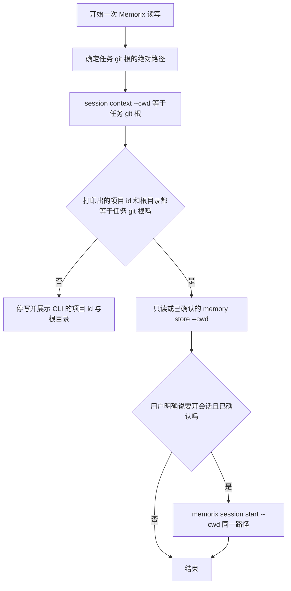

# 开锁提示词与跨工作区

本文件说明四种实际用法下怎么选分区、怎么停写、什么时候开会话。**默认路径是 memorix CLI + `--cwd`**；不因工具列表里有 MCP 而改用 MCP 读写。命令合同以 `SKILL.md`、`memory-operations.md`、`session-and-reasoning.md` 为准。

## 失效条件

本文件是说明，不是第二份命令合同。下面任一条件成立，本文件立即失效，不得再按其中的流程执行：

1. 本文件与 `SKILL.md`、`memory-operations.md`、`session-and-reasoning.md` 的任一句冲突。冲突时以那三份为准。
2. 当前安装的 `memorix session --help` 或 `memorix memory store --help` 不再把 `--cwd <git-project>` 列为项目参数，或 `memory store` 开始创建会话。
3. 用户明确要求全面改回「默认 MCP 读写」且技能正文已同步改写（当前未成立）。

失效之后只读三份命令合同。

## 两个轴

| 轴             | 怎么判定                                               | 不看什么                        |
| :------------- | :----------------------------------------------------- | :------------------------------ |
| 遗留开锁提示词 | 用户消息贴了「主动激活 memorix MCP」或同段「平台开锁」 | 口头说「用一下 memorix」不算    |
| 工作区         | 这次要读写的 git 根是否等于宿主当前工作区根            | agent 自称目录或 shell 当前目录 |

贴了遗留开锁提示词时：**先读本技能**。技能要求日常仍走 CLI + `--cwd`；提示词里不带 `--cwd` 的 `memorix session context` 必须改成 `memorix session context --cwd <任务 git 根的绝对路径>`。不要把提示词理解成「必须先装 MCP 或必须先 `session_start`」。

跨工作区：要读写的文件在另一个 git 根，或一次写入要落到两个 git 根。分区键是 `--cwd` 指向的根，不是宿主工作区名。

## 总流程（CLI 默认）

读这张图时记三条：

- 默认不调用 `memorix_session_start`，也不运行 `memorix session start`，除非用户明确说要开会话且已确认。
- `memory store --cwd` 不创建会话，也不会关掉别人的活动会话。
- 即使工具列表里有 memorix MCP，读写仍用上表的 CLI 命令，不用 MCP 的 search/store/resolve。

## 四种用法

### 1. 不贴开锁提示词，且不跨工作区

任务 git 根就是宿主当前工作区根。`--cwd` 用当前工作区绝对路径。只读与已确认存储都走 CLI；不调用 `memorix_session_start`，不运行 `memorix session start`（除非用户明确要开会话且已确认）。

### 2. 不贴开锁提示词，但跨工作区

`--cwd` 用**任务 git 根**，不用宿主根。先 `memorix session context --cwd <任务 git 根>`；打印出的 id 或根目录不对就停写。存储用 `memory store --cwd <任务 git 根>`。不在宿主根上运行 `memorix session start`。

### 3. 贴了遗留开锁提示词，且不跨工作区

先读技能，再执行提示词中与技能不冲突的部分。分区核对与读写仍走 CLI + `--cwd`。提示词若要求「第一件 MCP 调用是 `session_start`」，技能覆盖：默认不调用 `memorix_session_start`；只有用户**点名**必须用 MCP 开会话且已确认时，才走下文「非默认：MCP 开会话」。

### 4. 贴了遗留开锁提示词，且跨工作区

同上，但 `--cwd` 与若发生的 `session start` 都指向**任务 git 根**，不指向宿主根。

## 非默认：用户点名 MCP 开会话

仅当用户明确说「必须用 MCP / 要 `memorix_session_start`」且已确认开会话时：

1. 先向用户说明：日常默认是 CLI，MCP 开会话不是默认路径。
2. 确认前不调用 `memorix_session_start`（该调用会关掉该项目上一个活动会话）。
3. 确认后 `projectRoot` 等于任务 git 根的绝对路径，与同一条 `--cwd` 一致。
4. MCP 开会话失败或用户改为 CLI：用 `memorix session start --cwd <同一路径>`，不要重复 `memorix_session_start`，除非用户再次点名 MCP。

未点名 MCP 时：不调用 `memorix_session_start`；需要会话只用 CLI 的 `memorix session start --cwd`。

## 四种用法对照

| 用法                 | `--cwd` / 分区 | 存储                | 开会话                                            |
| :------------------- | :------------- | :------------------ | :------------------------------------------------ |
| 不贴开锁，不跨工作区 | 当前工作区根   | CLI `memory store`  | 仅用户明确确认 → CLI `session start`              |
| 不贴开锁，跨工作区   | 任务 git 根    | CLI 指向任务 git 根 | 同上，路径仍是任务 git 根                         |
| 贴开锁，不跨工作区   | 当前工作区根   | CLI                 | 默认不开；点名 MCP 才 `session_start`             |
| 贴开锁，跨工作区     | 任务 git 根    | CLI 指向任务 git 根 | 默认不开；点名 MCP 时 `projectRoot` 为任务 git 根 |

## 写之前仍然要停的情况

- 存储要单独确认。开锁段不写记忆。
- 同一项目、同一实体已有活动记忆时，不追加第二条。先 `detail` 已有 id，再请用户选更新或停止。
- `--topic-key` 写成「用途/对象」，不用裸实体名。
- `filesModified` 只填这次真实写入的文件；写完 detail 回读，出现未写路径就停。
- 不 resolve、不归档不是本对话写入的 id。
